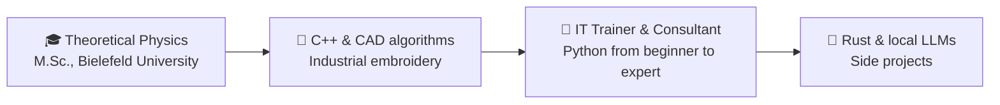

# Hi, I'm Thomas 👋

**Physicist at heart · Software developer by conviction · IT trainer by passion**

---

## ⚛️ The Lagrangian of my career

$$
\mathcal{L}_{\text{Thomas}} = \underbrace{\text{Physics}}_{\text{foundation}} + \underbrace{\text{Python}}_{\text{expertise}} + \underbrace{\text{C++ / Rust}}_{\text{performance}} + \underbrace{\text{Teaching}}_{\text{passion}}
$$

My principle of least action, applied to code: **maximum impact, minimum complexity** – and explaining complex things so they actually stick.

## 🔀 State transitions

## 🔭 What I'm currently into

- 📄 **Documind** – PDFs in, structured JSON out, powered by a **locally hosted LLM** instead of the cloud
- 🦀 **SealSoft Author** – a writing app for the terminal, built entirely in Rust
- 🎤 Teaching Python – from the first `print()` all the way to `asyncio`
- 💬 Ask me about: splines, test automation, RAG, or why physicists make good programmers

## ⟨ Observables ⟩

| Observable | Measured value |
|---|---|
| 🎤 Training courses delivered | **90+** |
| ⭐ Average participant rating | **4.8 / 5** |
| 📚 Course material written | **500+ double pages** |

## 🧪 Selected projects

<!-- TODO: link project names to their repos, e.g. [**Documind**](https://github.com/USERNAME/documind) -->

| Project | What it does | Stack |
|---|---|---|
| 📄 **Documind** | Full-stack app for automated document analysis: OCR plus a local LLM (Ollama) extract structured data; document types are configurable without code changes. Privacy by design. | FastAPI · React · PostgreSQL · Ollama · Docker |
| ✍️ **SealSoft Author** | Terminal app for writers: chapters, characters, plotlines, a rope-based text editor and word-count sparklines. | Rust · ratatui · ropey · serde |
| 🖧 **PuTTY Configurator** | Desktop tool for managing SSH, Telnet and serial connections – now standard software on our training machines. | Python · PyQt · PyInstaller |

## 🛠️ Toolbox

  
   
  
    
  
  

---

Always happy to talk physics, Python or Rust. 👋

